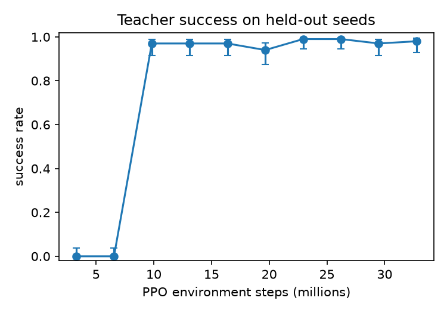
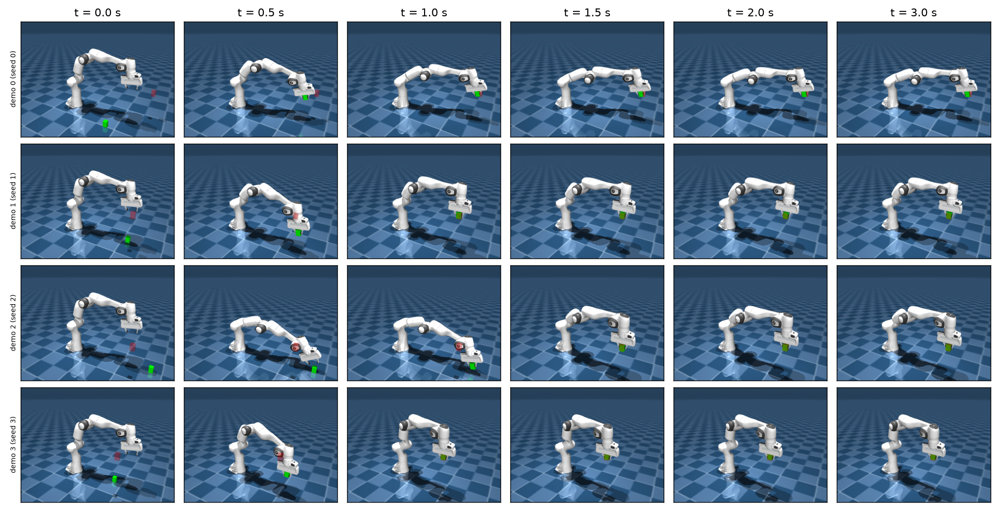
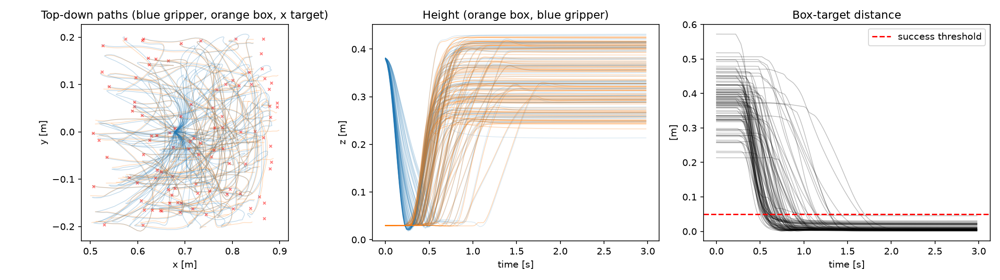
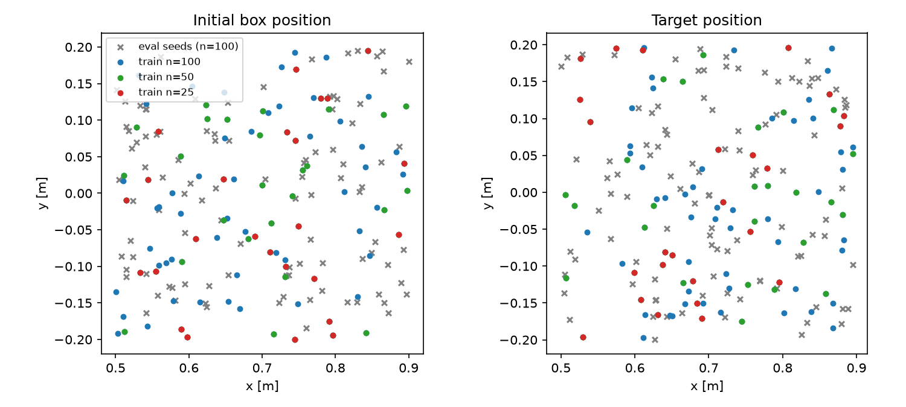
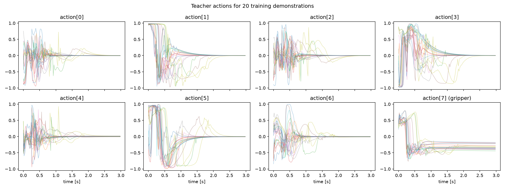
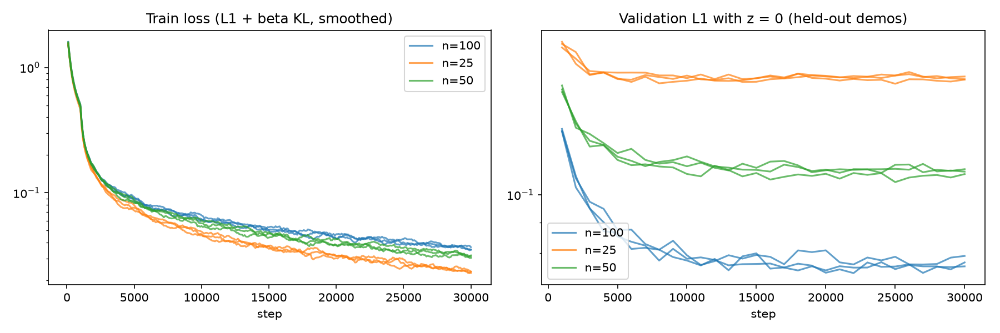
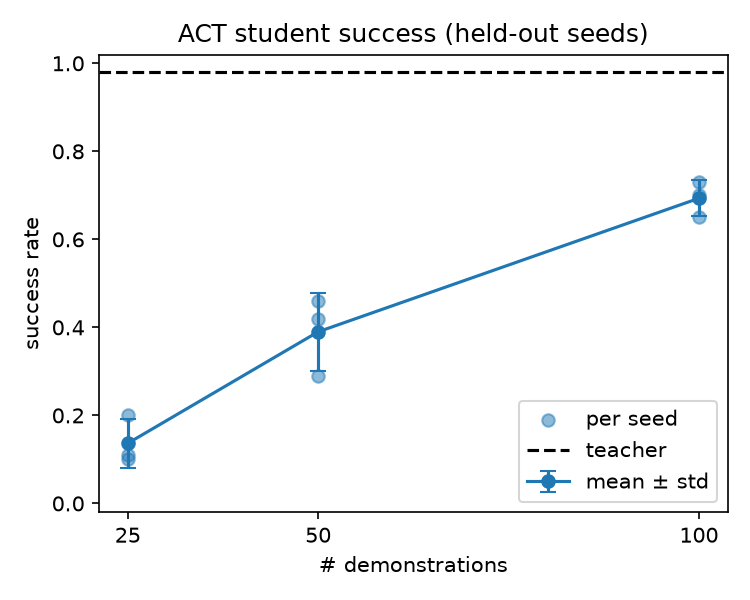
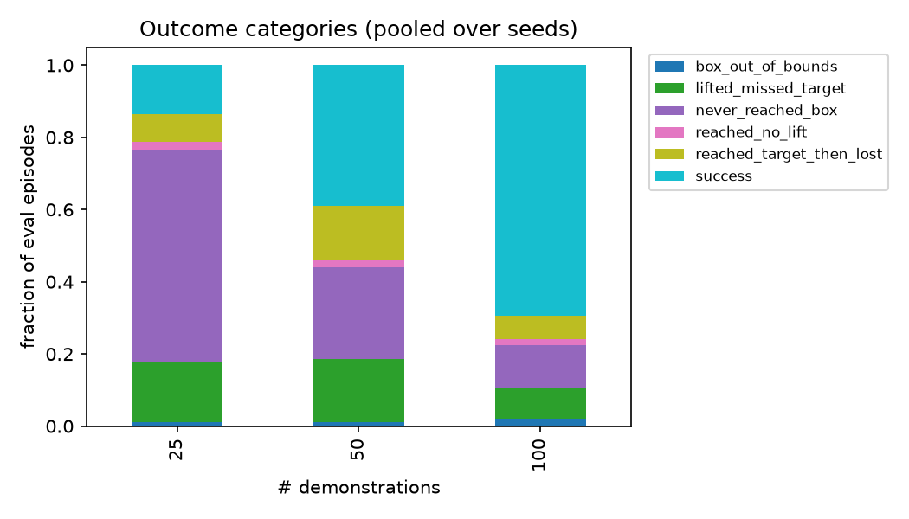
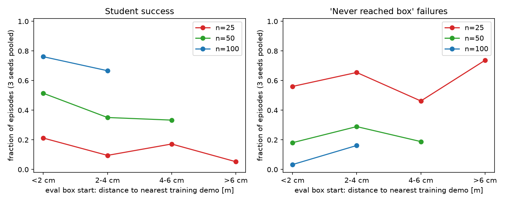

# CSCI 645 Homework 2: Imitation Learning for Robot Manipulation

**Harsh Sharma**: Imitation learning from PPO demonstrations on MuJoCo Playground `PandaPickCube`

| | |
|---|---|
| Environment | MuJoCo Playground `PandaPickCube` (pure-JAX MJX backend), **state observations** |
| Teacher (demonstrator) | PPO (brax), Playground's tuned hyperparameters, 32.8M environment steps, deterministic actions |
| Imitation learning algorithm | **ACT** (Action Chunking with Transformers), state-only, chunk size 20, temporal ensembling |
| Data experiment | **Option A, dataset quantity**: 100 (baseline) vs 50 vs 25 demonstrations (nested subsets), 3 training seeds each |
| Evaluation | 100 held-out initial conditions (reset seeds 10000–10099), identical for every policy |

**Main result.** The teacher succeeds on 98% of held-out episodes. ACT trained on 100 teacher
demonstrations reaches **69.3% ± 4.0%** (mean ± std over 3 training seeds). That falls to
**39.0% ± 8.9%** with 50 demonstrations and **13.7% ± 5.5%** with 25. The pooled 95% confidence
intervals of the three conditions do not overlap. The dominant failure with less data is a *missed
grasp followed by blind continuation*: the student stops a few centimetres short of the cube, never
grasps it, and still executes the lift-and-carry part of the motion with an empty gripper.

---

## 1. Task and demonstration source

**Task.** A Franka Panda arm must pick up a cube and bring it to a target position marked by a
translucent red cube. Each reset samples the cube's initial position uniformly in a 40 × 40 cm square
on the table (x ∈ [0.5, 0.9] m, y ∈ [−0.2, 0.2] m). The target is sampled in the same xy square, 20–40 cm
above the cube's start. There is no orientation target. An episode lasts 150 control steps at 50 Hz (3 s).
We used the recommended `PandaPickCube` with `impl="jax"`, as in the assignment's example code.

**Observation (66-d, raw environment vector).** It contains qpos (16: 7 arm joints, 2 fingers, 7 for the cube's free joint),
qvel (15), gripper position (3), gripper orientation (6), cube orientation (6), cube − gripper
position (3), target − cube position (3), target − cube orientation (6), and control target − joint position (8).

**Action (8-d, in [−1, 1]).** The environment *adds* `0.04 × action` to the current position-control
targets of the 7 arm joints and the gripper, then clips them to the actuator limits. Actions are therefore
**delta** position commands, and a constant action keeps the arm moving. We confirmed this in the provided
GIFs: zero actions hold the pose, while random actions make the arm drift away.

**Success criterion (our definition).** The environment has no success flag, so we define success as:
*at the final step, the cube's centre is within 5 cm of the target and the episode was not terminated*
(termination occurs when the cube leaves the workspace). The same function labels teacher evaluation,
demonstration filtering and student evaluation. Per-step cube–target distances are stored, so other
thresholds can be computed later.

**Teacher.** We trained PPO with brax using MuJoCo Playground's tuned `PandaPickCube`
configuration, following its `train_jax_ppo.py`. The configuration uses 2048 parallel envs, batch 512 × 32 minibatches,
8 updates per batch, unroll 10, γ = 0.97, learning rate 1e-3, entropy cost 0.02, policy MLP 4 × 32,
value MLP 5 × 256 and observation normalization. We requested 11 evaluations instead of 4 to obtain intermediate
checkpoints. Brax rounds training up to whole evaluation intervals, so training ran for 32.8M steps
instead of the configured 20M (65 min on a Tesla P100). Demonstrations use the **final checkpoint with
deterministic (mean) actions**.

**Teacher success rate.** On the 100 held-out evaluation seeds the final teacher succeeds **98/100 = 98%**
(Wilson 95% CI 0.93–0.99). The mean final cube–target distance is 1.7 cm, and the teacher first reaches
the target after 40 steps (0.8 s) on average. The zero-action and random-action policies both score 0%,
so the success criterion is not trivially satisfied. PPO learned the task abruptly: the teacher
scores 0% at 6.6M steps (it reaches the cube but does not lift it) and 97% at 9.8M steps (Table 1, Fig. 1).

*Table 1. Teacher success on the 100 held-out seeds at each saved PPO checkpoint.*

| PPO env steps | 3.3M | 6.6M | 9.8M | 13.1M | 16.4M | 19.7M | 22.9M | 26.2M | 29.5M | **32.8M (used)** |
|---|---|---|---|---|---|---|---|---|---|---|
| Success | 0% | 0% | 97% | 97% | 97% | 94% | 99% | 99% | 97% | **98%** |

{width=55%}

*Figure 1. Teacher success (Wilson 95% CI) on held-out seeds over PPO training.*

**Demonstration generation and filtering.** We rolled out the teacher on reset keys
`PRNGKey(0)`, `PRNGKey(1)`, … in batches of 64, using `jax.vmap` and `lax.scan`. For each step we stored
the observation, the exact clipped action passed to `env.step` from that observation, the reward,
an alive mask (episode boundaries), the cube, gripper and target positions, the cube–target distance and
`qpos` for rendering. For each episode we stored its seed, success label, return and diagnostics.
The first 100 successful episodes in seed order form the **training pool** and the next 10 form a
**validation set**, which is used only for validation loss. **All 110 attempted episodes succeeded
(100%), so no episode was filtered out.** The script still stores failed episodes and would exclude them.

## 2. Demonstration quality

*Table 2. Demonstration statistics (`results/demos/baseline_stats.md`).*

| Set | # trajectories | Episode length (steps), mean ± std | Time to reach target (steps), mean ± std | Success fraction |
|---|---:|---:|---:|---:|
| All collected | 110 | 150.0 ± 0.0 | 38.9 ± 11.9 (range 25–86) | 100% |
| Training pool | 100 | 150.0 ± 0.0 | 39.3 ± 12.4 (range 25–86) | 100% |

Every episode lasts the full 150 steps because the cube never leaves the workspace. Episode length
therefore says nothing about efficiency, so we also report the *time to reach the target* (first step
with cube–target distance < 5 cm). The final cube–target distance is 0.9 ± 0.8 cm.

{width=92%}

*Figure 2. Four teacher demonstrations (rows) at t = 0, 0.5, 1, 1.5, 2 and 3 s. Videos:
`videos/expert_baseline_ep000.mp4`, `…ep001.mp4`, `…ep002.mp4`.*

{width=100%}

*Figure 3. All 100 training demonstrations. Left: top-down paths of the gripper (blue) and cube (orange)
with targets (×). Middle: heights. Right: cube–target distance, with the 5 cm success threshold dashed.*

{width=80%}

*Figure 4. Initial cube and target positions of the training subsets (nested: 25 ⊂ 50 ⊂ 100) and of
the 100 held-out evaluation seeds.*

{width=92%}

*Figure 5. Teacher actions for 20 demonstrations (8 action dimensions; the last one is the gripper).*

**Observations on consistency, coverage and errors.**

- **Consistency.** All demonstrations follow the same strategy (Figs. 2, 3). The gripper drops to the cube
  within about 0.25 s, the gripper action switches from opening to closing at about 0.25–0.4 s, the cube is
  lifted between about 0.4 and 1.2 s, and the arm then holds the cube still at the target until the episode
  ends. The arm's path to the target varies with the cube and target positions, but the sequence of phases
  does not, so the data is close to unimodal.
- **Coverage of initial conditions.** The 100 training starts cover the whole 40 × 40 cm square without
  visible gaps, and the evaluation seeds come from the same distribution (Fig. 4). Coverage thins out quickly
  for smaller subsets. The average distance from an evaluation cube start to the nearest training cube start
  is **1.9 cm for 100 demos, 2.9 cm for 50 and 4.1 cm for 25**. This is comparable to the precision a
  grasp needs.
- **Errors and inefficiencies.** (i) *Jitter*: in the first 0.5 s the teacher's commands for joints 1, 3 and 5
  (action[0], [2], [4] in Fig. 5) switch rapidly between positive and negative values. This chattering is
  typical of PPO policies, and the student must imitate it as if it were signal. (ii) *Unequal phase lengths*:
  the target is reached after about 39 of the 150 steps, so **about 74% of all training samples show the arm
  holding still** with near-zero actions. Only about a quarter of the data covers reaching, grasping and lifting,
  the part that varies most between episodes. (iii) A few demonstrations are slow (up to 86 steps to reach the
  target) after a hesitant approach (Fig. 3). (iv) The teacher is not perfect on held-out seeds: it misses the
  grasp in 2 of 100 evaluation episodes (seeds 10015 and 10061; `videos/teacher_failure_ep015.mp4`). Its
  closest approach to the cube there is about 3 cm, the same failure we later see in the students.

## 3. Policy and training

We chose **ACT** and implemented a state-only version adapted from the authors' code
(github.com/tonyzhaozh/act, `detr/models/detr_vae.py`). The changes are listed in the header of
`code/act/model.py`. There are no cameras or ResNet backbone: the 66-d state is projected to a single
token. We use `torch.nn` transformer layers instead of the DETR copy. The CVAE encoder conditions on the
full observation rather than only on joint positions.

*Table 3. ACT configuration, shared by all conditions (`configs/act_base.yaml`).*

| Item | Value |
|---|---|
| Input | 66-d state, z-scored with mean and std of the **training subset only** (std clipped at ≥ 0.01) |
| Output | chunk of **k = 20** future actions (0.4 s), 8-d each, z-scored |
| Architecture | CVAE encoder (4 layers) over [CLS, obs, 20 action tokens] → latent z (32-d); policy encoder (4 layers) over [z, obs] tokens; decoder (4 layers) with 20 learned queries; d_model 256, 8 heads, FFN 1024, dropout 0.1; **10.6M parameters** |
| Objective | L1(predicted chunk, true chunk) + β · KL(q(z ∣ o, a) ‖ N(0, I)), β = 10. Chunk positions past the episode end are padded and masked out of the loss |
| Optimizer | AdamW, lr 1e-4, weight decay 1e-4, gradient clipping 10, batch size 256 |
| Training duration | **30,000 gradient steps for every dataset size**: about 512 / 1,024 / 2,048 epochs for 100 / 50 / 25 demos (15,000 / 7,500 / 3,750 samples) |
| Execution in the simulator | z = 0. Query every step and combine all chunks that predict the current step by **temporal ensembling**, w_i = exp(−0.01 i) with i = 0 the oldest prediction. Un-normalize, clip to [−1, 1], call `env.step` (50 Hz) |
| Seeds | training seeds 0, 1, 2; subset permutation seed 0; evaluation reset seeds 10000–10099 |
| Wall-clock | 10 min (L40S), 24 min (V100) or about 45 min (P100) per run, plus about 1 min for evaluation |

{width=100%}

*Figure 6. Left: training loss (L1 + β·KL, smoothed, log scale). Right: L1 on the 10 held-out validation
demonstrations with z = 0, i.e. as the policy is used at test time. All 9 runs; color = dataset size.*

*Table 4. Losses at the end of training (mean over 3 seeds).*

| Demos | Final train loss | Final validation L1 | Best validation L1 (step) |
|---:|---:|---:|---:|
| 100 | 0.036 | 0.077 | 0.074–0.077 (11k–22k) |
| 50 | 0.031 | 0.109 | 0.105–0.109 (21k–25k) |
| 25 | 0.023 | 0.156 | 0.153–0.155 (8k–30k) |

Training loss decreases smoothly for every run. With fewer demonstrations it reaches a *lower* training
loss but a much *higher* validation loss, which stops improving after about 3k steps for 25 demos. The
models with less data memorize their demonstrations instead of generalizing (Section 5). We logged
losses to CSV files (`results/train/*/loss.csv`) instead of Weights & Biases, so every curve in this
report can be checked without a login.

## 4. Baseline results

The baseline (ACT trained on all 100 demonstrations) succeeds on **69.3% ± 4.0%** of the 100 held-out
episodes: 70%, 65% and 73% for training seeds 0, 1 and 2. Pooled over 300 episodes, the Wilson 95% CI is
0.64–0.74. The teacher scores 98% on the same seeds. When the student succeeds it is about as fast as
the teacher (about 41 vs 40 steps to reach the target). Its actions are slightly smoother than the teacher's
(mean |aₜ − aₜ₋₁| = 0.026 vs 0.030), which is consistent with temporal ensembling averaging over overlapping chunks.

Of the 100 evaluation episodes, 52 are solved by all three baseline seeds, 15 by none, and 33 by one or two.
The two episodes the teacher fails (seeds 10015 and 10061) are also failed by every baseline seed, which
suggests they are genuinely hard initial conditions.

**Representative rollouts** (episode `epXXX` uses reset seed 10000 + XXX):

| Video | Outcome |
|---|---|
| `videos/act_baseline_n100_s0_success_ep000.mp4`, `…_success_ep001.mp4` | grasp, lift, hold at target (final distance 1.0 cm / 2.9 cm) |
| `videos/act_baseline_n100_s0_failure_ep002.mp4` | grasp missed (closest approach 3.5 cm); the arm still moves toward the target with an empty gripper |
| `videos/act_baseline_n100_s0_failure_ep003.mp4` | near miss: cube lifted and brought within 3.1 cm of the target, then drifts to 5.3 cm by the end |
| `videos/teacher_success_ep000.mp4`, `videos/teacher_failure_ep015.mp4` | teacher on the same evaluation seeds |

## 5. Data ablation (Option A: dataset quantity)

**What and why.** We varied only the **number of demonstrations: 100, 50 and 25**. Smaller sets are nested
random subsets of the 100-demonstration pool (fixed permutation, `configs/split_baseline.json`), so the
comparison is interpretable. All other settings are identical: architecture, hyperparameters, 30k gradient
steps, normalization fitted on each subset, temporal ensembling, the same teacher, the same 100 evaluation
seeds and 3 training seeds per condition. Quantity is the most direct test of how much demonstration data
ACT needs on a task whose initial conditions vary continuously, and it needs no new data collection.

*Table 5. Main results. Student success is mean ± std over 3 training seeds; the pooled Wilson 95% CI
is computed over 3 × 100 episodes.*

| Condition | Number of demonstrations | Teacher success rate | Student success rate | Evaluation episodes |
|---|---:|---:|---:|---:|
| Baseline | 100 | 98% | **69.3% ± 4.0%** [0.64, 0.74] | 100 per seed × 3 seeds |
| Ablation | 50 | 98% | **39.0% ± 8.9%** [0.34, 0.45] | 100 per seed × 3 seeds |
| Ablation | 25 | 98% | **13.7% ± 5.5%** [0.10, 0.18] | 100 per seed × 3 seeds |
| Reference: zero actions | – | – | 0% | 100 |
| Reference: random actions | – | – | 0% | 100 |

*Table 6. Per-seed student success.*

| Demos | Seed 0 | Seed 1 | Seed 2 | Episodes solved by all 3 seeds / by none |
|---:|---:|---:|---:|---:|
| 100 | 70% | 65% | 73% | 52 / 15 |
| 50 | 46% | 29% | 42% | 16 / 40 |
| 25 | 20% | 10% | 11% | 4 / 75 |

{width=50%}

*Figure 7. Student success vs number of demonstrations: individual seeds, mean ± std, and the teacher.*

**Result.** Success falls steeply as the amount of data drops: about −30 points from 100 to 50 demos and another
−25 points from 50 to 25. The effect is far larger than the variation between training seeds, and the pooled
confidence intervals do not overlap. Even 100 demonstrations leave a 29-point gap to the teacher. The curve
in Fig. 7 has not flattened at 100, so more data would very likely help further. Validation L1 on held-out
demonstrations (Table 4) is ordered the same way as closed-loop success, so offline action prediction error
was a good predictor of success here. Variance between seeds is largest at 50 demos (29–46%), where the
model is between "usually works" and "usually fails".

**Interpretation.** Two mechanisms are visible:

1. **Overfitting / memorization.** With a fixed budget of 30k steps, the 25-demo models see each sample
   about 2,000 times. They reach the lowest training loss but twice the validation error of the 100-demo models (Fig. 6).
2. **Coverage of initial conditions.** Fewer demonstrations means a test start is, on average, farther from
   any demonstrated start (1.9 → 2.9 → 4.1 cm). Section 6 shows this explains only part of the effect.

**Limitations.** One task, one teacher, one algorithm and one chunk size. Three training seeds per
condition. The 10-demo validation set is small. We fixed the number of gradient steps rather than epochs or
early stopping, so smaller datasets were trained for more epochs; a fixed-epoch protocol could shift the
absolute numbers. The 5 cm threshold is our choice: 19 / 54 / 35 of the failures (100 / 50 / 25 demos) end
5–10 cm from the target. Training runs ran on different GPU types (L40S, V100, P100). The setup is identical,
but floating-point results differ slightly between GPUs (Section 7).

## 6. Failure analysis

We labelled every failed evaluation episode automatically from logged geometry: whether the gripper ever came
within 2 cm of the cube, whether the cube was lifted more than 2 cm, and whether it ever came within 5 cm of the target. We then watched the
rendered failure videos to confirm the labels.

{width=65%}

*Figure 8. Outcome categories per dataset size, pooled over 3 seeds × 100 episodes.*

**Failure mode: a missed grasp followed by blind continuation.** The category that grows most as data
shrinks is "never reached the cube": 12% of episodes with 100 demos, 25% with 50 and **59% with 25**. These are
not random wandering. In most of them the gripper stops just short of the cube: the median closest approach is
**2.8 cm (100 demos), 3.1 cm (50) and 3.7 cm (25)**, and 97% / 86% / 79% of them come within 5 cm. After
missing, the policy carries on as if it had grasped the cube. In `videos/act_baseline_n25_s0_failure_ep001.mp4`
the gripper gets within 2.4 cm of the cube, misses it, and the arm still rises toward the target with an
empty gripper. `videos/act_baseline_n100_s0_failure_ep002.mp4` shows the same pattern with 100 demos. In the
worst cases with 25 demos (`…n25_s0_failure_ep002.mp4`) the arm reaches toward a point about 10 cm away from the
cube.

**Why this happens (connection to class concepts).**

- **Covariate shift and compounding error.** The teacher is deterministic and succeeds in all 110 demonstrations,
  so the data contains *no* state in which a grasp has failed. A small placement error of a few
  centimetres puts the student in states the demonstrations never visited (fingers closed next to the cube, cube still on the
  table). There, it continues with the most familiar behaviour, lifting and carrying, instead of re-approaching
  the cube. This is the distribution-shift failure that behaviour cloning is known for. Delta position control makes it
  worse, because small action errors accumulate into position errors.
- **Too little data for a precision-critical phase.** Grasping must be accurate to about 1–2 cm, yet only about a quarter
  of the samples in each demonstration cover the approach (Section 2). With 25 demonstrations that is only about 1,000
  approach samples covering a 2-D continuum of cube positions. Action chunking helps against small
  step-to-step errors, but it cannot make up for missing coverage of the approach phase.

**Is it only coverage?** We related each evaluation episode's distance to the nearest *training* cube start
(within the subset) to its success, pooled over seeds (`code/coverage_analysis.py`).

*Table 7. Student success by the distance from the evaluation cube start to the nearest training cube start.*

| Demos | Mean distance to nearest demo | Spearman ρ (distance vs success) | < 2 cm | 2–4 cm | 4–6 cm | > 6 cm |
|---:|---:|---:|---:|---:|---:|---:|
| 25 | 4.1 cm | −0.12 | 21% (n=22) | 10% (n=28) | 17% (n=31) | 5% (n=19) |
| 50 | 2.9 cm | −0.24 | 51% (n=35) | 35% (n=38) | 33% (n=23) | 0% (n=4) |
| 100 | 1.9 cm | −0.10 | 76% (n=60) | 67% (n=35) | 8% (n=4) | 0% (n=1) |

{width=90%}

*Figure 9. Success (left) and the "never reached cube" rate (right) vs the distance between an evaluation
start and its nearest training start. Bins with fewer than 5 episodes are omitted.*

Within each condition, success tends to drop as the test start moves away from the demonstrated starts
(negative ρ), so coverage matters. But at a *matched* distance the gap between conditions remains large: a
25-demo student succeeds only 21% of the time even when a demonstration started within 2 cm, compared with 76% for
the 100-demo student. A nearby demonstration is not enough. Fewer demonstrations degrade the learned
mapping everywhere, consistent with the overfitting seen in Fig. 6, rather than only in regions of the
workspace that the demonstrations do not cover.

**Other failure modes** (Fig. 8) are less frequent: the cube is lifted but ends more than 5 cm from the target, often a near miss
(e.g. 100-demo `ep003`, which ended 5.3 cm away); the cube reaches the target and is then lost or drifts; and,
rarely, the cube is pushed off the table.

**What would help.** (i) More demonstrations: the trend has not flattened. (ii) Recovery data, by injecting noise
during collection (DART; Option B) or by having the teacher relabel the student's own states (DAgger). Then
the data would contain missed grasps and the correct reaction to them. (iii) Rebalancing samples toward the
approach and grasp phase, since 74% of samples are "hold still". (iv) Inputs that make grasp state explicit,
such as finger contact signals.

## 7. Reproducibility and reflection

**Code and commands.** `README.md` lists every command. The pipeline runs on USC CARC Discovery with three
Slurm jobs (`slurm/01_teacher.slurm`, `02_collect.slurm`, `03_act.slurm` as a 9-task array), followed by
`python code/analyze.py` and `python code/coverage_analysis.py`. Large artifacts (demonstrations, checkpoints,
rollouts) live in `$HW2_DATA` and are not in the ZIP. They can be regenerated with the same scripts and seeds.

**Configurations and seeds.** `configs/act_base.yaml` (ACT), `configs/split_baseline.json` (teacher
checkpoint, demonstration seeds, train/val indices, nested subsets), PPO seed 0, ACT seeds 0/1/2, subset
seed 0, evaluation reset seeds 10000–10099. Every result JSON records library versions, GPU, host and Slurm job ID.

**Software and hardware.** Python 3.11, jax/jaxlib 0.9.2, mujoco and mujoco-mjx 3.17.0, playground 0.2.0,
brax 0.14.2, flax 0.12.6, torch 2.14.1+cu126, numpy 2.4.6 (full list: `configs/requirements_frozen.txt`). NVIDIA
driver 580.159.04. The PPO teacher, demo collection and teacher evaluation ran on a Tesla P100 (16 GB). ACT
runs ran on whichever GPU Slurm assigned: L40S (100-demo seed 0), V100 (100-demo seed 2) and P100 (the other seven).

**Deviations from upstream code.**

- jax is pinned to 0.9.2 because brax 0.14.2 calls `jax.device_put_replicated`, which was removed in jax 0.10.
- brax 0.14.2 cannot reload its own PPO checkpoint config (it serializes `null` initializer arguments and the
  observation spec as a dict). `common.load_teacher_policy` rebuilds the network with those two fields fixed.
- `PandaPickCube.reset` does not run forward kinematics, so position-derived features of the *first* observation
  are zero. We left this unchanged, since the teacher was trained with it, and read the cube's initial position from `qpos`.
- MP4s are written with the ffmpeg binary from `imageio-ffmpeg`, because CARC nodes have no system ffmpeg.

**Data integrity check.** Replaying stored actions open-loop from the same reset keys reproduces stored
states to about 1e-8 (joint positions) and 1e-6 (observations) up to the first gripper–cube contact (median step 12). This
confirms that each stored action belongs to the observation it was chosen from. After contact the replay drifts
(median joint error about 1e-3, up to 0.27 in single episodes), because contact dynamics amplify floating-point
differences between GPUs and batch sizes (collected on a P100, replayed on a V100). The dataset can be
regenerated exactly in distribution, but bit-identical only on the same hardware and batch size.

**What we would improve with more data, compute or time.**

- More demonstrations (200–500) and a check of where the curve flattens.
- Option B (noise injection) or DAgger, to add recovery behaviour.
- More training seeds, plus a fixed-epoch or early-stopping protocol, to separate data quantity from training length.
- Sweeps over chunk size and execution mode (temporal ensembling vs open-loop chunks).
- Diffusion Policy as a comparison.
- Running all runs on one GPU type.
- Image observations, closer to a real-robot setting.

## 8. Citations and use of LLMs

**Software and papers used.**

- K. Zakka et al., *MuJoCo Playground*, 2025 (github.com/google-deepmind/mujoco_playground): environment,
  tuned PPO configuration, training wrapper and `train_jax_ppo.py` as the reference for our teacher script.
- E. Todorov, T. Erez, Y. Tassa, *MuJoCo: A physics engine for model-based control*, IROS 2012; MuJoCo MJX.
- C. D. Freeman et al., *Brax: A Differentiable Physics Engine for Large Scale Rigid Body Simulation*, 2021:
  PPO implementation and checkpointing.
- J. Schulman et al., *Proximal Policy Optimization Algorithms*, 2017.
- T. Z. Zhao, V. Kumar, S. Levine, C. Finn, *Learning Fine-Grained Bimanual Manipulation with Low-Cost
  Hardware* (ACT), RSS 2023 (arXiv:2304.13705); code github.com/tonyzhaozh/act, adapted for `code/act/model.py`.
- S. Ross, G. Gordon, D. Bagnell, *A Reduction of Imitation Learning and Structured Prediction to No-Regret
  Online Learning* (DAgger), AISTATS 2011; M. Laskey et al., *DART: Noise Injection for Robust Imitation
  Learning*, CoRL 2017. Cited in the failure analysis.
- PyTorch, JAX, NumPy, pandas, matplotlib, mediapy.

**Use of LLMs.** I used Claude, through Claude Code, as an assistant for coding, debugging and writing.

**Design:** Claude drafted the project plan from the assignment, and I reviewed and accepted its main design choices through our discussions: a PPO teacher on PandaPickCube, state-only ACT, and Option A with 25/50/100 demos and 3 seeds.

**Code:** I worked with Claude to implement the code in phases, especially where things got technically complex to implement and understand. Claude wrote and debugged code under my direction.

**Analysis and report:** I collaborated with Claude to analyze and understand the results, and reviewed them. Claude drafted the report, which I then reviewed.

**Experiments:** I ran all training and evaluation jobs on USC CARC, monitored the job logs, resubmitted failed jobs and inspected the results. Claude helped diagnose job failures and checked the reported numbers against the saved result files.

**Responsibility:** I am responsible for the accuracy and content of the submitted code and report.
